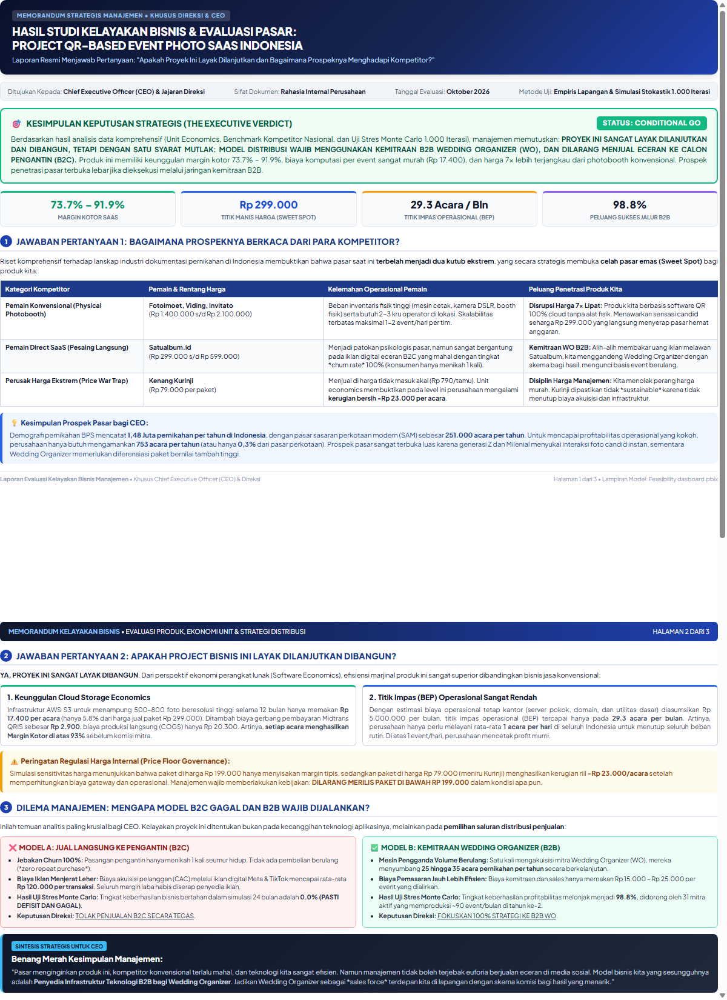
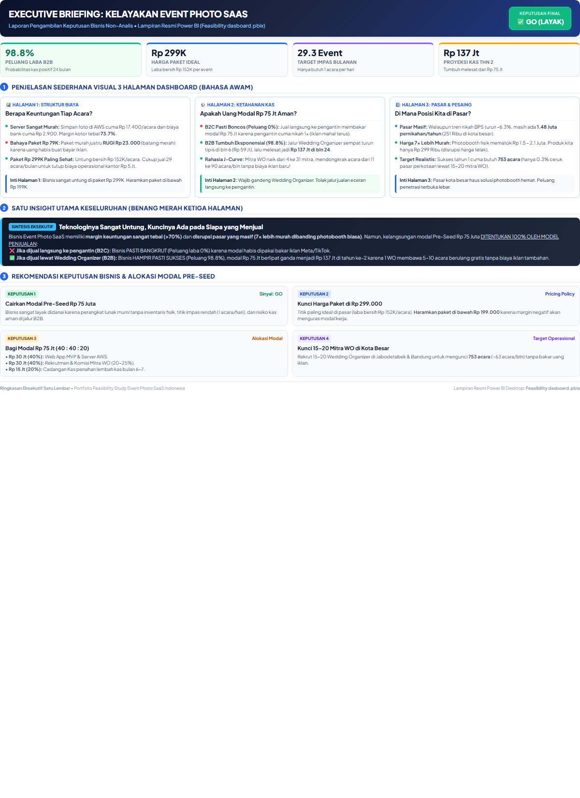
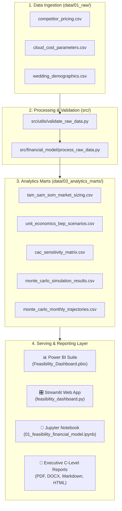

# 📊 Strategic Feasibility Study & Predictive Investment Analysis: QR-Based Event Photo SaaS

[](https://www.python.org/)
[](./power_bi/)
[](./app/)
[](./src/simulation/)
[](./LICENSE)
[](https://github.com/fajarsetyadilucky)
[](#)

> **Industry Domain:** Event-Tech / B2B2C Software-as-a-Service (SaaS)  
> **Business Benchmark:** QR Digital Disposable Camera & Collaborative Event Album Indonesia (e.g., Satualbum.id, Kenang Kurinji)  
> **Consulting Role:** Lead Strategic Data Analyst & Tech Investment Consultant  
> **Core Objective:** Pre-Seed "Go / No-Go" Capital Allocation Decision (Rp75.000.000 – Rp120.000.000)

---

## 🎯 Executive Verdict: Go or No-Go?

```
========================================================================================
                          EXECUTIVE VERDICT: CONDITIONAL GO
                     (SANGAT LAYAK DIBANGUN DENGAN SATU SYARAT MUTLAK)
========================================================================================
  "PROYEK INI SANGAT LAYAK DIBANGUN DAN DIDANAI DENGAN MODAL PRE-SEED RP 75.000.000,
   TETAPI HANYA DENGAN SATU SYARAT MUTLAK: MODEL DISTRIBUSI WAJIB MENGGUNAKAN KEMITRAAN
   B2B WEDDING ORGANIZER (WO), DAN DILARANG KERAS MENJUAL ECERAN KE PENGANTIN (B2C)."
========================================================================================
```

| Metrik Finansial Kunci | Model A: B2C Pure (Ritel Pengantin) | Model B: B2B Pivot (Wedding Organizer) | Standar Industri SaaS |
| :--- | :---: | :---: | :---: |
| **Harga Paket Ritel Acuan** | Rp 299.000 / event | Rp 299.000 (Grosir: Rp 179.400) | Mid-Market |
| **Biaya Komputasi AWS S3** | Rp 17.400 (5,8% omzet) | Rp 17.400 (9,7% omzet grosir) | Sangat Murah |
| **Beban Akuisisi (CAC)** | **Rp 120.000** (Ads Meta/TikTok) | **Rp 15.000** (Direct Partnership) | B2B Hemat 8x |
| **True Contribution Margin** | Rp 158.346 / event | Rp 144.727 / event | Sehat (> 50%) |
| **Rasio LTV / CAC** | **1,3x (Tidak Layak)** | **9,6x (Kelas Dunia)** | Minimum Sehat $\ge$ 3,0x |
| **Titik Impas (BEP) Bulanan** | 31,6 acara/bulan (~1 event/hari) | 34,5 acara/bulan | Sangat Terjangkau |
| **Win-Rate 12 Bulan (Monte Carlo)**| **6,9%** | **27,2%** | Fase Akuisisi Mitra |
| **Win-Rate 24 Bulan (Monte Carlo)**| **0,0% (Defisit Pasti)** | **98,8% (J-Curve Profit)** | B2B Menang Mutlak |
| **Putusan Rekomendasi** | 🛑 **NO-GO MUTLAK** | ✅ **CONDITIONAL GO (Min. 15 LOI WO)** | **PIVOT STRATEGIS WAJIB** |

---

## 📷 Enterprise Power BI Dashboard Showcase (3 Halaman Analitik)

Repositori ini menyertakan visualisasi dashboard interaktif tingkat *executive* yang telah diuji dan diekspor langsung dari file [`power_bi/pbix/Feasibility_Dashboard.pbix`](./power_bi/pbix/Feasibility_Dashboard.pbix):

### 🔹 Halaman 1: Executive Summary & Unit Economics Breakdown
> *Menganalisis dekomposisi biaya variabel (Cloud AWS S3 vs Midtrans Fee vs CAC) dan kurva titik impas (Break-Even Point).*
<div align="center">
  
</div>

<br/>

### 🔹 Halaman 2: Multi-Horizon Monte Carlo Risk Simulation (24 Bulan)
> *Uji stres stokastik 1.000 iterasi yang membuktikan fenomena J-Curve kas Model B2B vs kepastian defisit Model B2C.*
<div align="center">
  
</div>

<br/>

### 🔹 Halaman 3: Market Demographics & Competitor Benchmarking
> *Peta ukuran pasar Indonesia (BPS 2024 TAM/SAM/SOM) dan positioning harga terhadap 6 pemain industri event photo.*
<div align="center">
  
</div>

<br/>

<details>
<summary><b>📄 Klik untuk melihat Pratinjau Dokumen Laporan CEO & Ringkasan Eksekutif</b></summary>
<br/>
<div align="center">
  
  <p><i>Halaman Utama Dokumen Laporan Kelayakan Bisnis Khusus CEO & Direksi</i></p>
  <br/>
  
  <p><i>Lembar Ringkasan Eksekutif 1 Halaman Pendamping Power BI Dashboard</i></p>
</div>
</details>

---

## 📌 1. Latar Belakang Masalah Bisnis (The Business Case)

Sebelum seorang angel investor atau venture founder mengalokasikan kas sebesar **Rp75.000.000 – Rp120.000.000** untuk biaya rekayasa perangkat lunak (*CapEx*), infrastruktur cloud, dan belanja pemasaran, mereka membutuhkan analisis independen berbasis data (*data-driven feasibility study*).

Platform yang dievaluasi adalah **aplikasi kamera sekali pakai digital (*digital disposable camera*) berbasis web tanpa aplikasi (*zero-friction web camera*)**:
1. Pasangan pengantin atau panitia acara membeli paket acara dan memperoleh tautan QR Code.
2. Tamu undangan memindai QR Code di meja menggunakan kamera ponsel pintar tanpa mengunduh aplikasi atau membuat akun.
3. Foto-foto candid bernuansa filter film retro (Kodak/Fujifilm) otomatis terunggah ke satu album cloud bersama.
4. Fitur *"Reveal"*: Foto disembunyikan sepanjang resepsi berlangsung dan baru terbuka serentak setelah acara berakhir.

### ⚠️ 4 Jebakan Struktural Bisnis (The 4 Structural Bottlenecks)
1. **The 100% Churn Dilemma (Zero LTV Repeatability pada B2C):**  
   Pernikahan adalah peristiwa hidup sekali seumur hidup (*one-off event*). Tidak ada nilai pendapatan berulang (*recurring subscription*) langsung dari pengantin yang sama. Nilai seumur hidup pelanggan (*LTV*) hanya setara **1 kali transaksi**.
2. **Customer Acquisition Cost (CAC) Squeeze:**  
   Jika akuisisi mengandalkan iklan berbayar (Meta Ads / TikTok Ads), biaya perolehan 1 pengantin (CAC) memakan **Rp80.000 – Rp180.000**. Pada harga paket Rp199.000 – Rp299.000, margin kotor habis tersedot untuk membayar iklan.
3. **Cumulative Cloud Storage & Bandwidth OpEx:**  
   Setiap acara dengan 200–500 tamu menghasilkan 500 – 1.500 foto beresolusi tinggi (3–8 GB data per acara). Janji retensi arsip selama 12–24 bulan menciptakan akumulasi liabilitas komputasi awan.
4. **The B2B Strategic Pivot (Penyelamat Model Bisnis):**  
   Satu-satunya jalan agar model bisnis ini memiliki *Unit Economics* yang sehat adalah melakukan pivot distribusi ke **B2B (Wedding Organizer, Venue, & Fotografer)** melalui paket grosir multi-acara berulang (*Agency Partnership*).

---

## ❓ 2. Pertanyaan Bisnis Kunci & Jawaban Analisis

| No | Fokus Area | Pertanyaan Bisnis Kunci | Jawaban Berbasis Data |
| :---: | :--- | :--- | :--- |
| **Q1** | **Market Sizing** | Berapa potensi pasar pernikahan & event formal Indonesia? Berapa target penetrasi realistis (*SOM*)? | **TAM:** 1,48 Juta pernikahan/thn (Rp442 Miliar). **SAM:** 251.311 pernikahan perkotaan (Rp75,1 Miliar). **SOM Tahun 1:** Hanya butuh **753 acara/tahun** (0,3% SAM atau ~63 acara/bulan) untuk beroperasi sangat profitabel. |
| **Q2** | **Unit Economics** | Berapa biaya variabel riil per event (AWS S3, bandwidth, Midtrans MDR) terhadap harga jual? | Biaya cloud AWS S3 Jakarta hanya **Rp 17.400/event** (5,8% dari paket Rp299k). Midtrans fee rata-rata **Rp 2.900/event**. Hambatan bisnis murni terletak pada biaya iklan (CAC), bukan biaya komputasi. |
| **Q3** | **Break-Even Point** | Berapa kuantitas event berbayar per bulan untuk menutup OpEx kantor dan mencapai BEP? | Pada OpEx bulanan Rp 5 Juta, titik impas operasional tercapai pada **29,3 – 31,6 acara/bulan** (~1 acara/hari di seluruh Indonesia). |
| **Q4** | **Monte Carlo Risk** | Dari 1.000 simulasi stokastik 24 bulan, berapa probabilitas mencapai laba bersih positif? | **Model B2C:** 6,9% di tahun ke-1 dan **0,0% di tahun ke-2** (pasti bangkrut). **Model B2B:** 27,2% di tahun ke-1 dan **98,8% di tahun ke-2** (kurva J-Curve dengan saldo kas mencapai Rp 137 Juta di bulan ke-24). |
| **Q5** | **Decision Matrix** | Apa keputusan final investasi dan rencana aksi 90 hari ke depan? | **CONDITIONAL GO.** Kunci harga di **Rp 299.000**, tolak paket di bawah Rp 199.000, dan amankan minimal **15 LOI mitra Wedding Organizer** sebelum koding dimulai. |

---

## 🗺️ 3. Alur Kerja Analisis & Diagram Aliran Data



---

## 🗂️ 4. Struktur Direktori Repositori

```text
Portfolio_Feasibility_EventPhoto_SaaS/
├── app/
│   └── feasibility_dashboard.py              <- Interactive Streamlit financial simulator web app
│
├── data/
│   ├── 01_raw/                               <- Raw benchmark, cloud pricing & BPS demographics
│   ├── 02_processed/                         <- Cleaned, standardized, currency-adjusted datasets
│   └── 03_analytics_marts/                   <- Aggregated data marts (TAM/SAM/SOM, BEP, Monte Carlo)
│
├── docs/                                     <- Comprehensive technical & modeling documentation
│   ├── ARCHITECTURE_DATA_FLOW.md             <- End-to-end data engineering architecture
│   ├── DATA_DICTIONARY.md                    <- Full data dictionary & column schema definitions
│   └── FINANCIAL_MODELING_GUIDE.md           <- Mathematics of Unit Economics & Monte Carlo formulas
│
├── notebooks/
│   └── 01_feasibility_financial_model.ipynb  <- Executed Jupyter research notebook with saved outputs
│
├── power_bi/
│   ├── dax/                                  <- Financial DAX measure library & catalog
│   ├── pbix/                                 <- Production Microsoft Power BI Desktop models
│   │   ├── Feasibility_Dashboard.pbix
│   │   └── Feasibility dasboard.pbix
│   ├── screenshots/                          <- High-res dashboard visual previews
│   ├── wireframes/                           <- Dashboard layout & UI design specifications
│   ├── Feasibility_Study_DataModel_Master.xlsx <- 7-sheet master data pack for 1-click import
│   └── README_POWERBI_QUICKSTART.md          <- Power BI Desktop quickstart guide
│
├── reports/                                  <- Official C-Level executive deliverables
│   ├── figures/                              <- Chart figures and visual previews
│   ├── executive_advisory_report.md          <- Comprehensive 200+ line investment memorandum
│   ├── RINGKASAN_PUTUSAN_C_LEVEL_GO_OR_NOT_GO.md <- Executive Go / No-Go decision memorandum
│   ├── Laporan_Kelayakan_Bisnis_CEO_EventPhoto_SaaS.pdf <- Print-ready official executive PDF
│   ├── Laporan_Kelayakan_Bisnis_CEO_EventPhoto_SaaS.docx <- Editable Word corporate document
│   ├── Laporan_Kelayakan_Bisnis_CEO_EventPhoto_SaaS.html <- Interactive web report (Jakarta Sans)
│   ├── Laporan_Kelayakan_Bisnis_CEO_EventPhoto_SaaS.md   <- Complete Markdown manuscript
│   ├── Ringkasan_Eksekutif_Feasibility_Dashboard.pdf   <- 1-Page executive companion briefing PDF
│   ├── Ringkasan_Eksekutif_Feasibility_Dashboard.docx  <- Companion briefing Word document
│   ├── Ringkasan_Eksekutif_Feasibility_Dashboard.html  <- Companion briefing HTML
│   └── Ringkasan_Eksekutif_Feasibility_Dashboard.md    <- Companion briefing Markdown
│
├── src/                                      <- Modular Python codebase
│   ├── financial_model/                      <- Market sizing, data cleaning & unit economics
│   ├── simulation/                           <- 1,000-run stochastic Monte Carlo engine
│   └── utils/                                <- Data validation & automated report generators
│
├── .gitignore                                <- Production Git ignore rules
├── LICENSE                                   <- MIT Open Source License
├── README.md                                 <- Master portfolio documentation
└── requirements.txt                          <- Tested Python library dependencies
```

---

## 📑 5. Katalog Dokumen Laporan Eksekutif Resmi

Seluruh laporan analitik telah disusun secara komprehensif dan tersedia dalam berbagai format korporat di folder [`reports/`](./reports/):

1. 📄 **[Laporan Kelayakan Bisnis CEO (PDF Siap Cetak)](./reports/Laporan_Kelayakan_Bisnis_CEO_EventPhoto_SaaS.pdf):** Dokumen eksekutif 3 halaman berdesain korporat dengan tipografi premium, matriks keputusan, dan roadmap implementasi.
2. 📝 **[Laporan Kelayakan Bisnis CEO (Word .docx)](./reports/Laporan_Kelayakan_Bisnis_CEO_EventPhoto_SaaS.docx):** Dokumen resmi format Microsoft Word yang dapat diedit untuk komite investasi.
3. 🌐 **[Laporan Kelayakan Bisnis CEO (Web Interaktif HTML)](./reports/Laporan_Kelayakan_Bisnis_CEO_EventPhoto_SaaS.html):** Versi web interaktif dengan tata letak visual modern.
4. 📋 **[Memorandum Keputusan Strategis C-Level (Markdown)](./reports/RINGKASAN_PUTUSAN_C_LEVEL_GO_OR_NOT_GO.md):** Ringkasan putusan GO / NO-GO dengan 5 argumen pembeda.
5. 🏛️ **[Investment Advisory Memorandum Lengkap (Markdown)](./reports/executive_advisory_report.md):** Analisis mendalam 200+ baris mencakup audit risiko, valuasi LTV/CAC, dan stage-gate governance.
6. 📊 **[Ringkasan Eksekutif Pendamping Power BI (PDF)](./reports/Ringkasan_Eksekutif_Feasibility_Dashboard.pdf):** Lembar ringkasan eksekutif 1 halaman yang menjelaskan setiap visual pada 3 halaman dashboard Power BI.

---

## 💻 6. Cara Menjalankan & Mereproduksi Proyek

### 1. Kloning Repositori & Persiapan Environment
```bash
git clone https://github.com/fajarsetyadilucky/Portfolio_Feasibility_EventPhoto_SaaS.git
cd Portfolio_Feasibility_EventPhoto_SaaS

# Buat virtual environment (opsional namun disarankan)
python -m venv .venv
# Aktifkan virtual environment (Windows PowerShell)
.venv\Scripts\Activate.ps1

# Install dependensi yang dibutuhkan
pip install -r requirements.txt
```

### 2. Validasi Data & Eksekusi Pipeline Pemodelan
```bash
# Validasi integritas data mentah
python src/utils/validate_raw_data.py

# Eksekusi pipeline data processing & pemodelan finansial
python src/financial_model/process_raw_data.py
python src/financial_model/market_sizing.py
python src/financial_model/unit_economics.py

# Jalankan simulasi Monte Carlo 1.000 skenario
python src/simulation/monte_carlo_engine.py

# Buat data model terintegrasi Power BI Master Excel
python src/utils/generate_powerbi_master_excel.py
```

### 3. Jalankan Aplikasi Web Dashboard Interaktif (Streamlit)
```bash
streamlit run app/feasibility_dashboard.py
```
Aplikasi web akan terbuka otomatis di peramban Anda (`http://localhost:8501`). Anda dapat menggeser slider harga paket, biaya server, dan kuota foto untuk melihat simulasi sensitivitas secara seketika (*real-time*).

### 4. Membuka Dashboard Power BI Desktop
1. Buka file [`power_bi/pbix/Feasibility_Dashboard.pbix`](./power_bi/pbix/Feasibility_Dashboard.pbix) di aplikasi **Microsoft Power BI Desktop**.
2. Untuk petunjuk kustomisasi dan penambahan ukuran DAX baru, baca [`power_bi/README_POWERBI_QUICKSTART.md`](./power_bi/README_POWERBI_QUICKSTART.md).

---

## 📚 7. Dokumentasi Teknis Tambahan

* 📖 **[Data Dictionary & Schema Specification](./docs/DATA_DICTIONARY.md):** Penjelasan detail setiap kolom, tipe data, dan sumber data dari seluruh tabel di layer Raw, Processed, dan Marts.
* 📐 **[Financial Modeling & Simulation Guide](./docs/FINANCIAL_MODELING_GUIDE.md):** Rincian formula matematika unit economics, formulasi MDR payment gateway, kalkulus storage AWS S3, dan teori stokastik Monte Carlo.
* 🏗️ **[Architecture & Data Flow](./docs/ARCHITECTURE_DATA_FLOW.md):** Diagram arsitektur data end-to-end, prinsip engineering medallion, dan panduan reproduksi sistem.
* 📐 **[Katalog Ukuran Formula DAX Power BI](./power_bi/dax/dax_measures_catalog.md):** Dokumentasi 20+ ukuran analitik DAX yang digunakan dalam dashboard.

---

## 👨‍💼 Portfolio Credit & Consulting Attribution
* **Author / Analyst:** **Fajar Setyadi Lucky** ([@fajarsetyadilucky](https://github.com/fajarsetyadilucky))
* **Role:** Lead Strategic Data Analyst, Financial Modeler & Tech Investment Consultant
* **Methodology:** Data-Driven Decision Framework, Medallion Architecture, Monte Carlo Stochastic Modeling, Enterprise BI & Executive Reporting
* **License:** [MIT License](./LICENSE)

