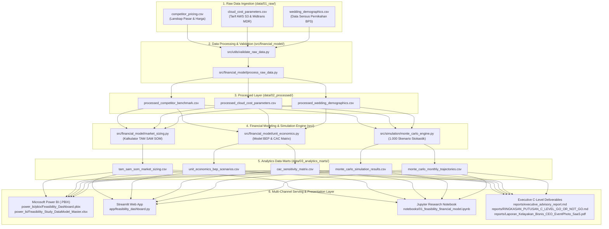

# 🏗️ Architecture & Data Engineering Flow

Dokumen ini menjelaskan arsitektur sistem, aliran data (*Data Flow*), struktur direktori, dan panduan reproduksi (*pipeline execution*) dari repositori ini.

---

## 🗺️ Diagram Arsitektur Data End-to-End



---

## 📁 Struktur Direktori Repositori Terstandarisasi

```text
Portfolio_Feasibility_EventPhoto_SaaS/
├── .vscode/                                  <- Pengaturan workspace VS Code
│   └── settings.json
│
├── app/                                      <- Aplikasi Web Interaktif Klien
│   └── feasibility_dashboard.py              <- Streamlit interactive simulator
│
├── data/                                     <- Layer Partisi Data (Medallion)
│   ├── 01_raw/                               <- Data mentah riset pasar & cloud
│   │   ├── cloud_cost_models/
│   │   ├── market_benchmark/
│   │   └── wedding_event_demographics/
│   ├── 02_processed/                         <- Data hasil standardisasi & pembersihan
│   │   ├── processed_cloud_cost_parameters.csv
│   │   ├── processed_competitor_benchmark.csv
│   │   └── processed_wedding_demographics.csv
│   └── 03_analytics_marts/                   <- Data agregasi mart analitik
│       ├── cac_sensitivity_matrix.csv
│       ├── monte_carlo_monthly_trajectories.csv
│       ├── monte_carlo_simulation_results.csv
│       ├── tam_sam_som_market_sizing.csv
│       └── unit_economics_bep_scenarios.csv
│
├── docs/                                     <- Dokumentasi Teknis Komprehensif
│   ├── ARCHITECTURE_DATA_FLOW.md             <- Arsitektur sistem & aliran data
│   ├── DATA_DICTIONARY.md                    <- Kamus data lengkap & skema kolom
│   └── FINANCIAL_MODELING_GUIDE.md           <- Panduan matematika finansial & Monte Carlo
│
├── notebooks/                                <- Eksplorasi & Analisis Interaktif
│   └── 01_feasibility_financial_model.ipynb  <- Jupyter Notebook dengan output komputasi
│
├── power_bi/                                 <- Artefak Microsoft Power BI
│   ├── dax/                                  <- Formula DAX & katalog ukuran finansial
│   │   ├── dax_measures_catalog.md
│   │   └── financial_measures.dax
│   ├── pbix/                                 <- Model Power BI Desktop resmi
│   │   ├── Feasibility_Dashboard.pbix
│   │   └── Feasibility dasboard.pbix
│   ├── screenshots/                          <- Pratinjau visual dashboard untuk GitHub
│   │   ├── CEO_Report_Page1_Preview.png
│   │   └── Dashboard_Executive_Overview.png
│   ├── wireframes/                           <- Spesifikasi layout & wireframe UI
│   │   ├── dashboard_layout_spec.md
│   │   └── dashboard_specs.md
│   ├── Feasibility_Study_DataModel_Master.xlsx <- Data model Excel multi-tabel 1-klik
│   └── README_POWERBI_QUICKSTART.md          <- Panduan setup Power BI Desktop
│
├── reports/                                  <- Dokumen Rekomendasi Resmi Eksekutif
│   ├── figures/                              <- Grafik & pratinjau visual laporan
│   │   ├── daftar_portofolio_data_analyst.png
│   │   ├── Laporan_CEO_P1_Preview.png
│   │   ├── Laporan_CEO_Preview.png
│   │   └── Ringkasan_Eksekutif_Preview.png
│   ├── executive_advisory_report.md          <- Memorandum kelayakan investasi (200+ baris)
│   ├── RINGKASAN_PUTUSAN_C_LEVEL_GO_OR_NOT_GO.md <- Memorandum keputusan strategis C-Level
│   ├── Laporan_Kelayakan_Bisnis_CEO_EventPhoto_SaaS.pdf <- Laporan resmi CEO format cetak
│   ├── Laporan_Kelayakan_Bisnis_CEO_EventPhoto_SaaS.docx <- Laporan resmi CEO format Word
│   ├── Laporan_Kelayakan_Bisnis_CEO_EventPhoto_SaaS.html <- Laporan versi web interaktif
│   ├── Laporan_Kelayakan_Bisnis_CEO_EventPhoto_SaaS.md   <- Naskah lengkap Markdown
│   ├── Ringkasan_Eksekutif_Feasibility_Dashboard.pdf   <- Ringkasan 1 halaman dashboard
│   ├── Ringkasan_Eksekutif_Feasibility_Dashboard.docx  <- Dokumen Word ringkasan
│   ├── Ringkasan_Eksekutif_Feasibility_Dashboard.html  <- Versi HTML ringkasan
│   └── Ringkasan_Eksekutif_Feasibility_Dashboard.md    <- Naskah Markdown ringkasan
│
├── src/                                      <- Source Code Python
│   ├── financial_model/                      <- Modul pemrosesan data & pemodelan
│   │   ├── market_sizing.py
│   │   ├── process_raw_data.py
│   │   └── unit_economics.py
│   ├── simulation/                           <- Mesin simulasi Monte Carlo
│   │   └── monte_carlo_engine.py
│   └── utils/                                <- Skrip utilitas & reporting automation
│       ├── calibrate_print.py
│       ├── check_pdf_pages.py
│       ├── generate_ceo_executive_report.py
│       ├── generate_executive_brief.py
│       ├── generate_notebook.py
│       ├── generate_powerbi_master_excel.py
│       ├── generate_visual_executive_report.py
│       ├── measure_pages.py
│       └── validate_raw_data.py
│
├── .gitignore                                <- Aturan pengabaian cache & file lokal Git
├── LICENSE                                   <- Lisensi repositori (MIT License)
├── README.md                                 <- Halaman muka portofolio profesional utama
└── requirements.txt                          <- Daftar dependensi Python teruji
```

---

## ⚡ Panduan Eksekusi Pipeline Ulang (Reproducibility)

Untuk mereproduksi seluruh pipeline dari awal hingga akhir:

```bash
# 1. Validasi integritas data mentah
python src/utils/validate_raw_data.py

# 2. Pematangan data (01_raw -> 02_processed)
python src/financial_model/process_raw_data.py

# 3. Eksekusi pemodelan pasar dan unit economics (02_processed -> 03_analytics_marts)
python src/financial_model/market_sizing.py
python src/financial_model/unit_economics.py

# 4. Eksekusi simulasi prediktif Monte Carlo (1.000 iterasi)
python src/simulation/monte_carlo_engine.py

# 5. Bangun Data Model Master Power BI (.xlsx)
python src/utils/generate_powerbi_master_excel.py

# 6. Jalankan Dashboard Interaktif Streamlit
streamlit run app/feasibility_dashboard.py
```
