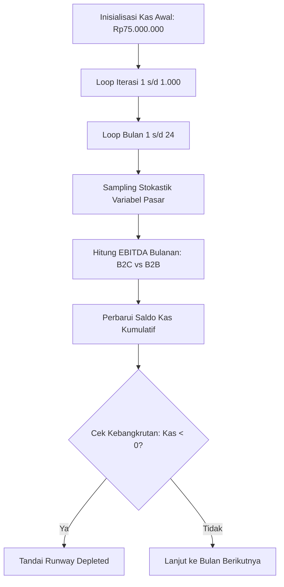

# 📐 Financial Modeling & Simulation Methodology Guide

Panduan ini menjabarkan fondasi matematika finansial, metodologi pemodelan biaya komputasi awan, analisis titik impas (*Break-Even Point*), dan teori simulasi stokastik Monte Carlo yang diterapkan dalam studi kelayakan ini.

---

## 1. Pemodelan Unit Economics & Margin Kontribusi

Dalam bisnis Software-as-a-Service (SaaS) berbasis pemrosesan data multimedia, biaya variabel per unit dipengaruhi oleh penyimpanan arsip foto dan kuota transfer data.

### 1.1 Biaya Cloud Storage & Bandwidth AWS S3 (Jakarta Region - `ap-southeast-3`)
Setiap acara pernikahan menghasilkan muatan data:
$$\text{Storage Size (GB)} = \frac{N_{\text{photos}} \times S_{\text{photo (MB)}}}{1024}$$

Biaya penyimpanan komputasi awan AWS S3 Standard selama masa retensi album (12 bulan):
$$\text{Storage Cost (IDR)} = \text{Storage Size (GB)} \times R_{\text{S3 (USD/GB-month)}} \times 12 \times \text{Kurs USD/IDR}$$

Biaya transfer data keluar (*Egress Data Transfer Out*):
$$\text{Egress Cost (IDR)} = \text{Storage Size (GB)} \times \text{Download Ratio} \times R_{\text{Egress (USD/GB)}} \times \text{Kurs USD/IDR}$$

Total beban cloud per event:
$$C_{\text{cloud}} = \text{Storage Cost} + \text{Egress Cost}$$

*Dengan parameter acuan:* 500 foto @ 5 MB = 2.44 GB; Tarif S3 = $0.025/GB-bln; Egress = $0.132/GB; Kurs = Rp16.500/USD ➔ **$C_{\text{cloud}} \approx \text{Rp17.400 per event}$** (~5.8% dari harga jual paket Rp299.000).

---

### 1.2 Bauran Biaya Payment Gateway (Midtrans Blended Rate)
Konsumen Indonesia menggunakan berbagai metode pembayaran digital:
* QRIS (MDR 0.7%) — bobot transaksi 60%
* E-Wallet / GoPay (MDR 2.0%) — bobot transaksi 20%
* Virtual Account Bank (Flat Rp4.000) — bobot transaksi 20%

Rumus Blended Payment Gateway Fee:
$$\text{Fee}_{\text{PG}} = (0.60 \times P \times 0.007) + (0.20 \times P \times 0.02) + (0.20 \times 4000)$$

---

### 1.3 True Contribution Margin (CM)
Margin Kontribusi Riil per unit dihitung setelah mengurangkan seluruh biaya variabel dan biaya perolehan pelanggan (CAC):
$$\text{Contribution Margin (CM)} = P - C_{\text{cloud}} - \text{Fee}_{\text{PG}} - \text{CAC}$$

$$\text{CM Ratio (\%)} = \left( \frac{\text{CM}}{P} \right) \times 100\%$$

* **Model A (B2C Pure):** $\text{CAC} \approx \text{Rp120.000}$ (Iklan digital Meta/TikTok berbayar).
* **Model B (B2B WO Partner):** Harga grosir $P_{\text{wholesale}} = P \times (1 - \text{Diskon WO})$; $\text{CAC}_{\text{amortized}} \approx \text{Rp15.000}$ (Biaya sales B2B diamortisasi terhadap puluhan acara per mitra).

---

## 2. Analisis Titik Impas (Break-Even Point)

Dengan biaya operasional tetap bulanan (*Fixed OpEx*) sebesar **Rp5.000.000/bulan** (mencakup server inti database, domain, pemeliharaan teknis part-time, dan lisensi kerja):

### 2.1 BEP Kuantitas Acara Bulanan
$$\text{BEP Volume (Events/Bulan)} = \frac{\text{Fixed OpEx Bulanan}}{\text{Unit Contribution Margin (CM)}}$$

Jika $\text{CM} \le 0$, maka $\text{BEP} = \infty$ (**Infeasible / Model Merugi Secara Struktural**).

Pada paket acuan **Rp299.000**:
* B2C Unit CM = Rp158.346 ➔ $\text{BEP} = \frac{5.000.000}{158.346} \approx \mathbf{31.6\text{ event/bulan}}$ (~1 event/hari).
* B2B Unit CM = Rp144.727 ➔ $\text{BEP} = \frac{5.000.000}{144.727} \approx \mathbf{34.5\text{ event/bulan}}$.

---

## 3. Dinamika LTV-to-CAC Ratio: Perbedaan B2C vs B2B

Customer Lifetime Value (LTV) dirumuskan sebagai:
$$\text{LTV} = \frac{\text{Gross Contribution Margin per Event} \times \text{Jumlah Transaksi Seumur Hidup}}{\text{Churn Rate}}$$

### Paradoks B2C (The 100% Churn Trap)
Pernikahan adalah peristiwa sekali seumur hidup (*one-off life event*):
* Frekuensi Pembelian Ulang (*Repeat Rate*) = 0%
* Retensi = 0 Bulan
* $\text{LTV} = 1 \times \text{Margin Kontribusi Kotor} \approx \text{Rp158.000}$
* $\text{CAC} \approx \text{Rp120.000}$
* **Rasio LTV / CAC B2C:** $\frac{158.000}{120.000} \approx \mathbf{1.3x}$ (Di bawah standar kelayakan SaaS minimum 3.0x).

### Efek Roda Gila B2B (The B2B Flywheel)
Mitra Wedding Organizer mengelola banyak acara per tahun:
* Rata-rata 1 WO menyelenggarakan 25 hingga 35 pernikahan per tahun.
* Churn tahunan agensi WO sangat rendah (~4%–5%).
* Biaya akuisisi 1 mitra WO = Rp300.000 (biaya presentasi & sales kit).
* Nilai laba kotor tahunan per WO = $30 \times \text{Rp145.000} = \text{Rp4.350.000}$.
* **Rasio LTV / CAC B2B:** $\frac{\text{LTV}_{\text{WO}}}{\text{CAC}_{\text{WO}}} \approx \mathbf{9.6x}$ (Standar kelas dunia SaaS).

---

## 4. Mesin Simulasi Prediktif Monte Carlo (1.000 Skenario)

Untuk mengantisipasi ketidakpastian kondisi pasar riil, model menggunakan pendekatan **Stokastik Multi-Horizon (12 dan 24 Bulan)** dengan $N = 1.000$ iterasi.

### 4.1 Distribusi Variabel Acak yang Digunakan:
1. **Average Order Value (AOV):** Distribusi Segitiga (*Triangular Distribution*)
   $$\text{AOV} \sim \text{Triangular}(\text{low}=199.000, \text{mode}=299.000, \text{high}=439.000)$$
2. **Kuantitas Foto per Acara:** Distribusi Seragam (*Uniform Distribution*)
   $$N_{\text{photos}} \sim \text{Uniform}(300, 1000)$$
3. **CAC Akuisisi B2C:** Distribusi Normal Terpancung (*Clipped Gaussian*)
   $$\text{CAC}_{\text{B2C}} \sim \text{Clip}(\mathcal{N}(\mu=120.000, \sigma=25.000), 75.000, 190.000)$$
4. **Pertambahan Mitra WO Baru:** Proses Poisson (*Poisson Arrival Process*)
   $$\Delta \text{WO} \sim \text{Poisson}(\lambda=1.2\text{ di Thn 1}, \lambda=1.8\text{ di Thn 2})$$
5. **Volume Acara per Mitra WO:**
   $$V_{\text{WO}} \sim \text{Uniform}(2.2, 3.5)\text{ event/mitra/bulan}$$

### 4.2 Hasil Uji Stres Probabilitas:
* **Tahun 1 (Bulan 12):**
  * Win-Rate B2C: **6.9%** (Mayoritas impas tipis atau defisit).
  * Win-Rate B2B: **27.2%** (Masih berada dalam fase investasi modal akuisisi mitra awal).
* **Tahun 2 (Bulan 24):**
  * Win-Rate B2C: **0.0%** (Kepastian defisit mutlak akibat 100% Churn).
  * Win-Rate B2B: **98.8%** (Kurva *J-Curve* meledak berkat akumulasi 25–35 mitra aktif).
