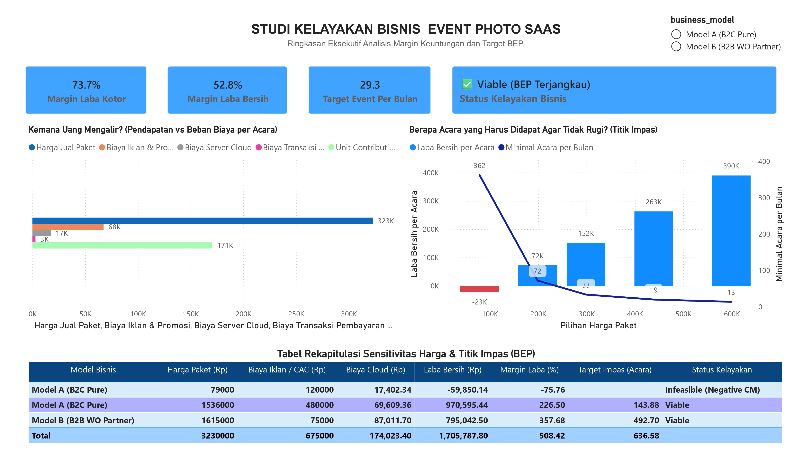
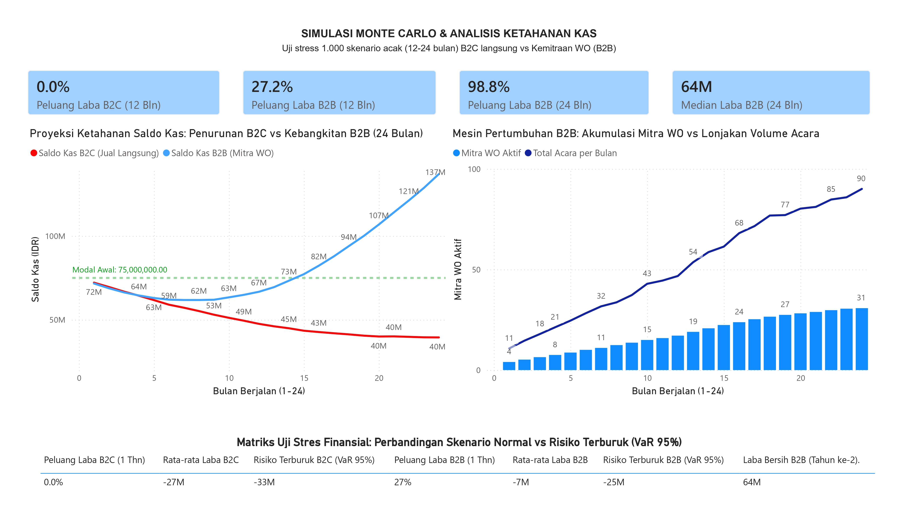
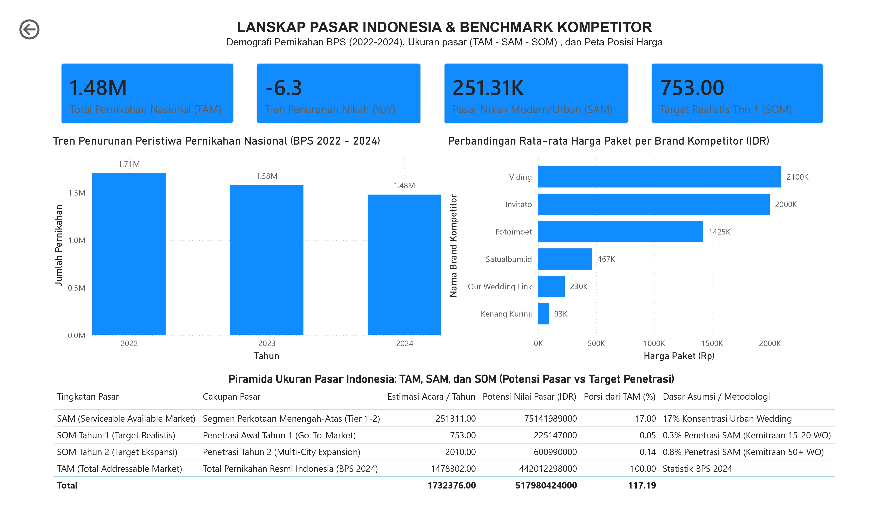

# 🚀 Panduan Cepat Setup Dashboard Power BI (.PBIX)

Dokumen ini adalah panduan teknis langsung bagi Anda untuk membuka data di **Power BI Desktop**, memuat data model dalam 1 klik, mengaplikasikan formula DAX, dan menyimpannya sebagai file `.pbix`.

---

## 📂 Mengapa File `.pbix` Dibuat Melalui Power BI Desktop?
Format file `.pbix` adalah format arsip biner terenkripsi berlisensi resmi Microsoft yang membungkus database engine internal (**VertiPaq / Analysis Services**). Oleh karena itu, file `.pbix` resmi harus diinisiasi dan di-save langsung oleh aplikasi Power BI Desktop agar tidak mengalami *corruption* atau *invalid format error*.

Kami telah menyiapkan **seluruh fondasi dan artefak siap saji**:
1. 📊 **Pre-built File PBIX Siap Buka:** [`power_bi/pbix/Feasibility_Dashboard.pbix`](./pbix/Feasibility_Dashboard.pbix) (Langsung buka di Power BI Desktop).
2. 📦 **Master Data Pack:** [`power_bi/Feasibility_Study_DataModel_Master.xlsx`](./Feasibility_Study_DataModel_Master.xlsx) (7 sheet tabel fakta & dimensi sudah terstruktur rapi).
3. 📐 **Koleksi Formula DAX:** [`power_bi/dax/financial_measures.dax`](./dax/financial_measures.dax) (20+ rumus keuangan & simulasi).
4. 📋 **Katalog Ukuran DAX:** [`power_bi/dax/dax_measures_catalog.md`](./dax/dax_measures_catalog.md).
5. 🖼️ **Spesifikasi Wireframe:** [`power_bi/wireframes/dashboard_layout_spec.md`](./wireframes/dashboard_layout_spec.md).
6. 📷 **Pratinjau Dashboard Visual:** Tersedia di folder [`power_bi/screenshots/`](./screenshots/).

---

## ⚡ Langkah Cepat (3-5 Menit ke File PBIX Siap Pakai)

### Langkah 1: Buka Power BI Desktop & Muat Data
1. Buka aplikasi **Power BI Desktop** di laptop Anda.
2. Pada layar utama / ribbon **Home**, klik tombol **Get data** ➔ pilih **Excel workbook**.
3. Navigasikan ke folder proyek Anda dan pilih:
   ```text
   power_bi/Feasibility_Study_DataModel_Master.xlsx
   ```
4. Di jendela **Navigator**, beri tanda centang pada **semua tabel/sheet**:
   - `Fact_UnitEconomics_BEP`
   - `Fact_MonteCarlo_Simulations`
   - `Fact_Monthly_Cashflow_Paths`
   - `Dim_Competitor_Benchmark`
   - `Dim_Wedding_Demographics`
   - `Dim_Market_Sizing`
   - `Dim_CAC_Sensitivity`
5. Klik tombol kuning **Load** (Tunggu beberapa detik hingga seluruh tabel masuk ke Data Pane sebelah kanan).

---

### Langkah 2: Tambahkan DAX Measures (Tinggal Copy-Paste)
Buka file `power_bi/dax/financial_measures.dax` di editor Anda, lalu di Power BI:
1. Klik kanan pada tabel `Fact_UnitEconomics_BEP` di panel kanan ➔ pilih **New measure**.
2. Salin dan tempel formula kunci berikut (atau formula lainnya dari file DAX):
   - **Contribution Margin %:**
     ```dax
     Contribution Margin Pct = DIVIDE([Contribution Margin IDR], [Total Revenue IDR], 0)
     ```
   - **BEP Volume:**
     ```dax
     BEP Target Volume Events = DIVIDE(5000000, [Unit Contribution Margin IDR], BLANK())
     ```
   - **B2B 12M Win Rate:**
     ```dax
     B2B Win Rate Pct = 
     DIVIDE(
         CALCULATE(COUNTROWS('Fact_MonteCarlo_Simulations'), 'Fact_MonteCarlo_Simulations'[Model] = "B2B_WO" && 'Fact_MonteCarlo_Simulations'[Final_Cash_Balance_IDR] > 0),
         CALCULATE(COUNTROWS('Fact_MonteCarlo_Simulations'), 'Fact_MonteCarlo_Simulations'[Model] = "B2B_WO"),
         0
     )
     ```

---

### Langkah 3: Susun 3 Halaman Sesuai Blueprint & Hasil Final

#### Halaman 1: Executive Summary & Unit Economics
- **KPI Cards:** Drag ukuran `Gross Margin Pct`, `BEP Target Volume Events`, `Pre-Seed CapEx Budget (Rp75 Juta)`.
- **Waterfall Chart:** Dekomposisi Paket Rp299k dikurangi Cloud Cost (Rp17,4k), Midtrans Fee (Rp6,7k), dan CAC (Rp120k B2C vs Rp25k B2B).
- **Line & Clustered Column Chart:** Kurva Titik Impas (BEP) dari `Fact_UnitEconomics_BEP`.



---

#### Halaman 2: Monte Carlo Predictive Risk Simulation
- **Histogram / Clustered Column:** Distribusi `Net_Profit_IDR` dari `Fact_MonteCarlo_Simulations` (Bandingkan kurva B2C vs B2B).
- **Line Chart (Spaghetti Plot):** Sumbu X = `Month` (1–24), Sumbu Y = `Cash_Balance_IDR`, Legend = `Iteration_ID` dari `Fact_Monthly_Cashflow_Paths`. Tambahkan Constant Line di `Y = 0` (Garis Kebangkrutan).
- **Slicer:** Filter kolom `Model` (B2C vs B2B) dan `Horizon_Months` (12 vs 24).



---

#### Halaman 3: Market Demographics & Competitor Benchmarking
- **Clustered Bar Chart:** Sumbu X = `Tahun` (2022, 2023, 2024), Sumbu Y = `Jumlah_Pernikahan` dari `Dim_Wedding_Demographics`.
- **Scatter Plot:** Sumbu X = `Max_Guests`, Sumbu Y = `Price_IDR`, Legend = `Competitor_Name` dari `Dim_Competitor_Benchmark`.



---

### Langkah 4: Simpan File PBIX
1. Klik **File** ➔ **Save As**.
2. Simpan di direktori proyek:
   ```text
   power_bi/pbix/Feasibility_Dashboard.pbix
   ```
3. File sekarang tersimpan secara permanen dan siap dibuka, diedit, atau dipresentasikan kapan saja!

